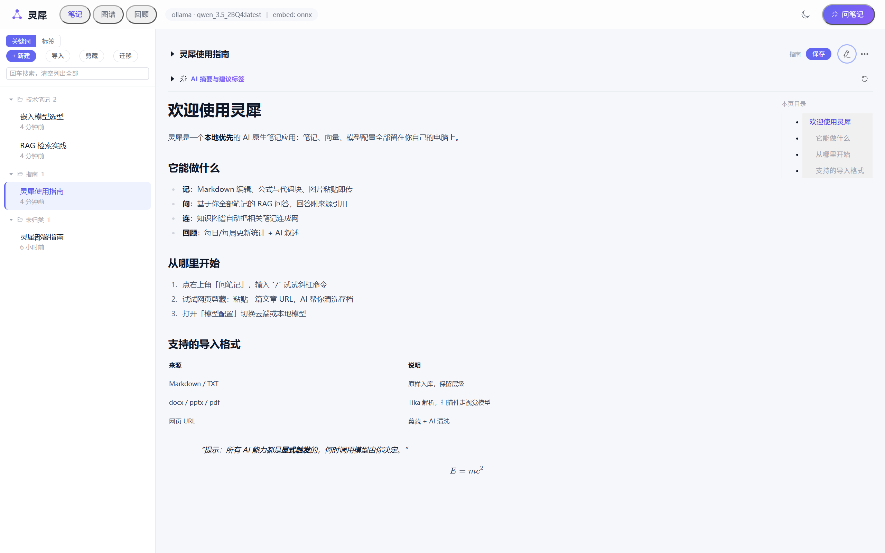
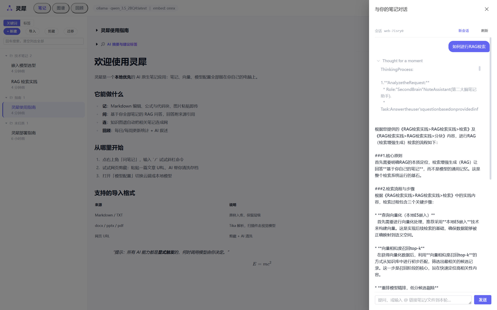
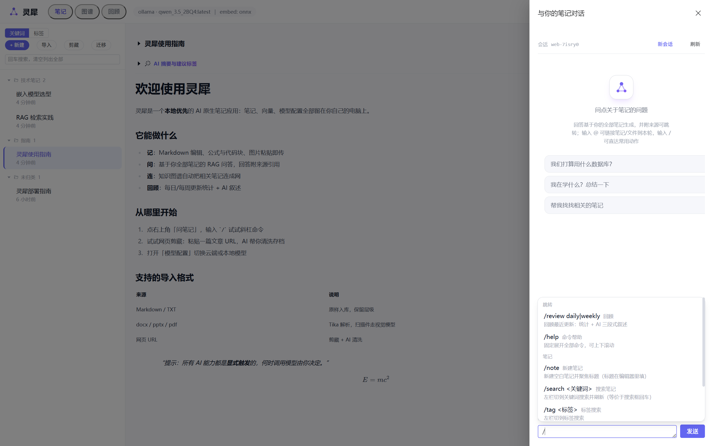

# LingXi 灵犀

> A local-first, AI-native note app that runs on your own machine — notes that talk back: grounded Q&A, a knowledge graph, and reviews, all kept offline.

English | [中文](README.md)



## What is this

LingXi puts "taking notes" and "asking your notes" into the same local app:

- **All data stays on your machine** — notes, vectors, and model config live in local files. No cloud dependency.
- **RAG answers are grounded in your own notes**, and every answer ships with citations you can click through to the source text.
- **The AI suggests, you decide** — tag/summary suggestions are explicitly triggered; when tokens get spent is your call.

## Features

**Notes**
- Markdown editor with edit/preview toggle, formulas, code blocks, paste-to-upload images, and a per-page table of contents
- Multi-level folders, tags, and dual search (keyword + semantic)
- Web clipper (AI-cleaned content, images stored locally), multi-format import (md/docx/pptx/pdf/images)
- One-shot migration from a local markdown folder (idempotent, safe to re-run)
- AI enrichment: tag suggestions + summaries (explicitly triggered)

**AI Q&A (RAG)**
- Streaming answers with source citations (click to jump to the original note)
- Thinking-process fold box: works with thinking models such as qwen3.5 / DeepSeek R1 — height-capped with auto-scroll while streaming, reviewable afterwards
- @-mention notes / local files / uploaded attachments as context for the current turn



**Slash commands**

Type `/` to reach common actions: `/search` notes, `/clip` a web page, `/summarize` the current note, `/review` for recaps... `/help` lists them all. Unknown input is sent as a normal message — never blocked.



**Knowledge network & review**
- Knowledge graph: notes auto-linked by shared tags and semantic neighbors
- Daily / weekly review: update stats plus an AI-written narrative
- Related-note recommendations and semantic search

**Multi-platform & models**
- Web UI + an optional Tauri desktop shell
- Hot-swap models: cloud OpenAI-compatible endpoints (Zhipu GLM, DeepSeek, ...) ⇄ local Ollama — changes apply instantly, no restart
- Local embedding + local reranking (optional GPU sidecar); the whole chain runs offline

## Quick start

### Prerequisites

- JDK 21, Maven (no wrapper — install it system-wide), Node.js 18+
- An LLM: a cloud API key, or a local [Ollama](https://ollama.com) instance
- Embedding model files (local ONNX — see `models/README.md`; they are not in the repo and the app fails to start without them)

### Run

```bash
# 1. Backend (port 8080; the database is created on first launch,
#    and a legacy vector file is migrated into it automatically)
mvn spring-boot:run

# 2. Frontend in dev mode (port 5173, /api proxied to 8080)
cd frontend && npm ci && npm run dev
```

Open `http://localhost:5173` in your browser.

### Release build

```bash
# Frontend output goes to src/main/resources/static, then packaged into a single jar
cd frontend && npm ci && npm run build && cd .. && mvn package
java -jar target/lingxi.jar   # open http://localhost:8080 for the full app
```

### Desktop installer (optional)

```bash
# requires target/lingxi.jar from the mvn package step above
cd src-tauri && node ../frontend/node_modules/@tauri-apps/cli/tauri.js build
# → src-tauri/target/release/bundle/nsis/*.exe
```

- Must be run from inside `src-tauri/`: tauri-cli looks for `tauri.conf.json` downward from the current directory
- **The installer ships no model files** (~1.1 GB): download them from HuggingFace afterwards, following the
  《模型放置说明.txt》 guide left in the install directory
- **JDK 21+** is required at runtime (`java` on PATH)

### Optional components

| Component | Notes | Without it |
|---|---|---|
| Reranker sidecar | `reranker-service/setup.bat` once, then `start.bat` (GPU-accelerated re-ranking) | Falls back to the local CPU ONNX scorer, log warning only |
| Tauri desktop shell | `src-tauri/` — build `target/lingxi.jar` first | Web form only |

## Model configuration

Click the model badge in the top bar to open the "Model Config (hot swap)" dialog:

- **Two provider channels**: cloud OpenAI-compatible (base-url + api-key, e.g. Zhipu GLM or DeepSeek) ⇄ local Ollama (no key, default `http://localhost:11434`)
- **Per-provider memory**: each provider keeps its own model/base-url/key — switching back and forth never overwrites the other side
- **Test connection**: sends a ping with the form values before saving; failures come back in plain language
- **Model suggestions**: the input suggests models you have actually configured, not a hardcoded list
- **Hot swap**: saving applies immediately (new conversations, no restart); config persists to `data/runtime-config.json`

Precedence: dialog override > `application.yml` defaults > the `LLM_API_KEY_demo_glm_4_7_flash` environment variable (the built-in Zhipu demo tier in yml).

**Thinking models**: pull a qwen3.5-family model in Ollama and you get the thinking fold box (height-capped scrolling, reviewable afterwards); DeepSeek R1 on a cloud endpoint works the same way.

## Data & privacy

- Everything lives in the `data/` directory: `notes.mv.db` (notes + chunks + vectors — one file to back up) and `runtime-config.json` (model config)
- Embedding and re-ranking run on local ONNX by default; with a local Ollama model, **nothing ever leaves your machine**
- Relative paths resolve against the process working directory — start the app from the repository root

## Development

```bash
mvn test                # unit tests (offline, seconds, no models/keys needed)
```

- `postman/` holds the API acceptance suite: `postman collection run "postman/collections/second-brain api" -e "postman/environments/Local.environment.yaml"`
- `doc/` contains design and decision records (requirements, architecture, and the trade-off log behind each milestone)
- Primarily developed and verified on Windows; see `doc/03-技术选型.md` for stack details

## License

Released under the [MIT License](LICENSE). 
