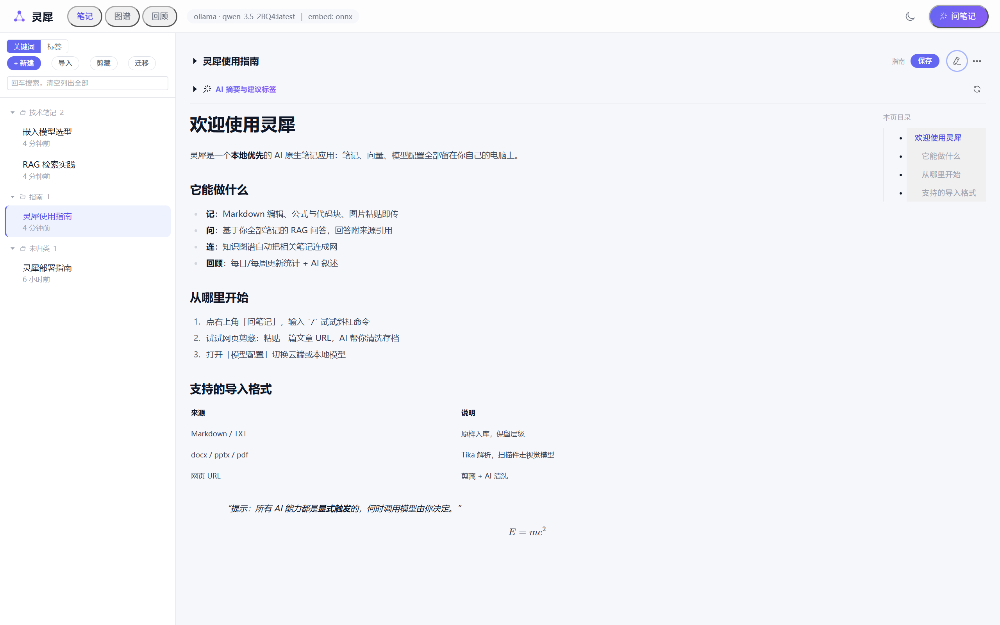
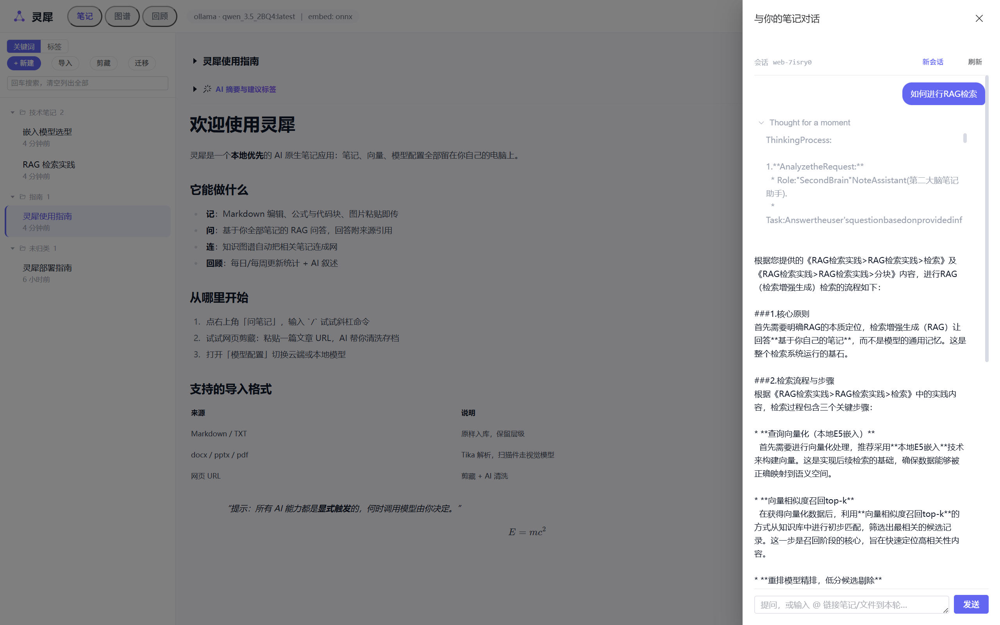
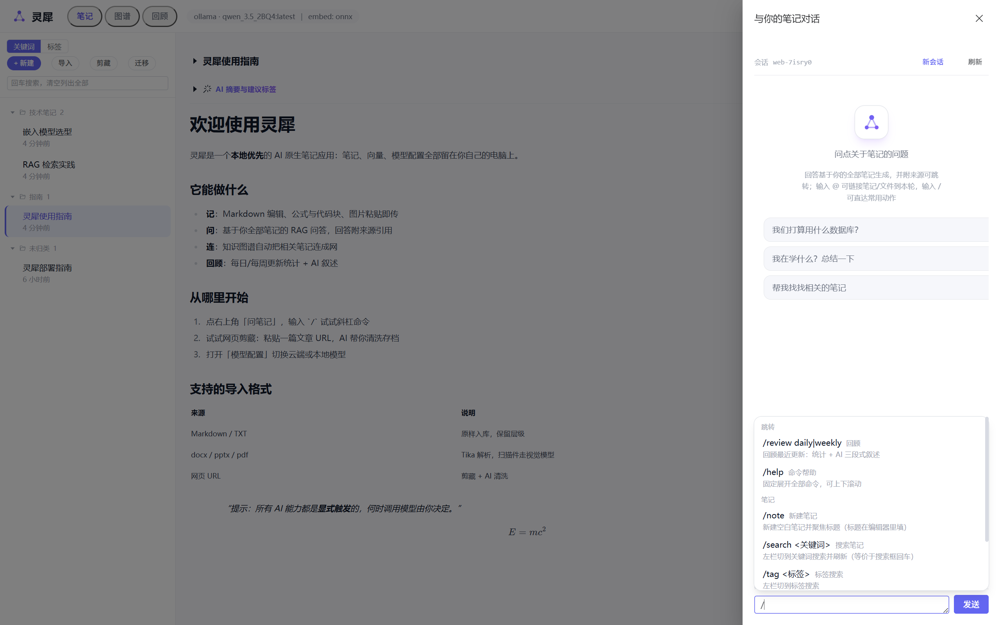

# 灵犀 LingXi

> 一个运行在自己电脑上的 AI 原生笔记应用——笔记不再只是记录，而是能与你对话、帮你联想的「第二大脑」。

中文 | [English](README.en.md)



## 这是什么

灵犀把「记笔记」和「问笔记」放进了同一个本地应用：

- **所有数据留在本机**——笔记、向量、模型配置全部落在本地文件，无云端依赖
- **RAG 问答基于你自己的笔记**，每条回答附来源引用，点击可回溯原文
- **AI 是建议者，你是决策者**——标签/摘要建议显式触发，何时花 token 由你决定

## 功能特性

**笔记**
- Markdown 编辑 / 预览切换、公式与代码块、图片粘贴上传、本页目录
- 多层文件夹、标签、关键词 + 语义双搜索
- 网页剪藏（AI 清洗正文、图片自动本地化）、多格式导入（md/docx/pptx/pdf/图片）
- 旧仓库一键迁移（本机 md 文件夹 → 灵犀，幂等可重跑）
- AI 富化：标签建议 + 摘要（显式触发）

**AI 问答（RAG）**
- 流式回答 + 来源引用（点击跳转原文）
- 思考过程折叠框：支持 qwen3.5 / DeepSeek R1 等 thinking 模型，推理过程限高滚动、完成后可回看
- @ 链接笔记 / 本地文件 / 上传附件作为本轮上下文



**斜杠命令**

输入 `/` 直达常用动作：`/search` 搜索、`/clip` 网页剪藏、`/summarize` 总结当前笔记、`/review` 回顾……`/help` 展开全部，未知输入原样发送不拦截。



**知识网络与回顾**
- 知识图谱：共标签 + 语义近邻自动连线
- 每日 / 每周回顾：更新统计 + AI 三段式叙述
- 相关笔记推荐、AI 语义搜索

**多端与模型**
- Web（浏览器访问）+ 可选 Tauri 桌面壳
- 模型热切换：云端 OpenAI 兼容（智谱/DeepSeek…）⇄ 本地 Ollama，改完即生效无需重启
- 本地嵌入 + 本地重排（可选 GPU 加速），嵌入与问答全链路可离线

## 快速开始

### 环境要求

- JDK 21、Maven（无 wrapper，需系统安装）、Node.js 18+
- 一个 LLM：云端 API Key，或本地 [Ollama](https://ollama.com)
- 嵌入模型文件（本地 ONNX，见 `models/README.md`，克隆后需自行放置，缺失会启动失败）

### 启动

```bash
# 1. 后端（8080 端口；首次启动自动建库，并把旧版向量文件自动迁移进数据库）
mvn spring-boot:run

# 2. 前端开发模式（5173 端口，/api 代理到 8080）
cd frontend && npm ci && npm run dev
```

浏览器打开 `http://localhost:5173` 即可使用。

### 发布形态

```bash
# 前端产物输出到 src/main/resources/static，随后打成单个 jar
cd frontend && npm ci && npm run build && cd .. && mvn package
java -jar target/lingxi.jar   # 打开 http://localhost:8080 即是完整应用
```

### 桌面安装包（可选）

```bash
# 必须先有 target/lingxi.jar（上面那条 mvn package 的产物）
cd src-tauri && node ../frontend/node_modules/@tauri-apps/cli/tauri.js build
# → src-tauri/target/release/bundle/nsis/*.exe
```

- 必须在 `src-tauri/` 目录里执行：tauri-cli 从当前目录向下找 `tauri.conf.json`
- **安装器不携带模型文件**（约 1.1GB）：装完按目录里的《模型放置说明.txt》从 HuggingFace 下载
- 运行时需要 **JDK 21+**（`java` 命令在 PATH 中）

### 可选组件

| 组件 | 说明 | 缺省会怎样 |
|---|---|---|
| 重排 sidecar | `reranker-service/setup.bat` 一次 + `start.bat`（GPU 加速检索精排） | 自动回退本地 CPU ONNX，仅日志提示 |
| Tauri 桌面壳 | `src-tauri/`，打包前先构建 `target/lingxi.jar` | 仅用 Web 形态 |

## 模型配置

顶栏模型徽标打开「模型配置（热切换）」对话框：

- **双 provider 通道**：云端 OpenAI 兼容（填 base-url + api-key，如智谱 GLM、DeepSeek）⇄ 本地 Ollama（免密钥，默认 `http://localhost:11434`）
- **按 provider 记忆**：每家的模型/地址/密钥分槽保存，来回切换互不覆盖、无需重填
- **测试连接**：保存前发一条 ping 验证连通性，失败给白话原因
- **模型联想**：输入框提示的是你配置过的模型，不是预置清单
- **热切换**：保存即生效（新对话生效，无需重启）；配置持久化在 `data/runtime-config.json`，重启不丢

优先级：对话框覆盖 > `application.yml` 默认值 > 环境变量 `LLM_API_KEY_demo_glm_4_7_flash`（yml 内置的智谱 demo 档位）。

**思考模型**：本地 Ollama 拉 qwen3.5 系模型即可看到思考过程折叠框（限高滚动，完成后可回看）；云端 DeepSeek R1 同样支持。

## 数据与隐私

- 全部数据在 `data/` 目录：`notes.mv.db`（笔记 + 分块 + 向量，单文件备份即可）、`runtime-config.json`（模型配置）
- 嵌入、重排默认本地 ONNX 推理；用本地 Ollama 时**全链路零外发**
- 相对路径以进程工作目录解析，建议从仓库根目录启动

## 本地开发

```bash
mvn test                # 单元测试（离线，秒级，无需模型/密钥）
```

- `postman/` 是接口验收套件：`postman collection run "postman/collections/second-brain api" -e "postman/environments/Local.environment.yaml"`
- `doc/` 是设计与决策记录（需求分析、架构、各里程碑的取舍日志）
- 主要在 Windows 下开发验证；技术栈细节见 `doc/03-技术选型.md`

## License

[MIT](LICENSE) © 2026 2401_87089860
